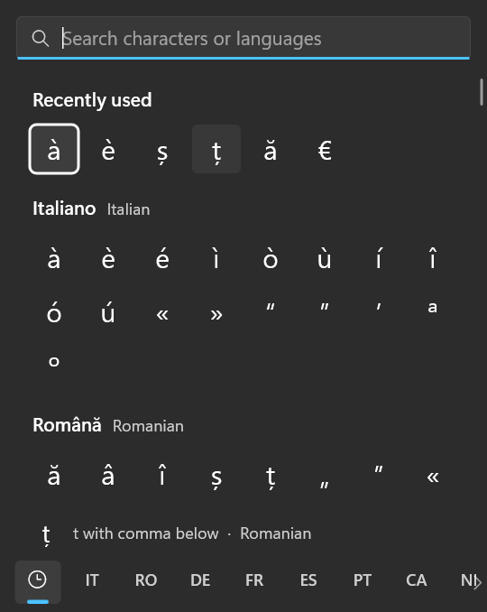
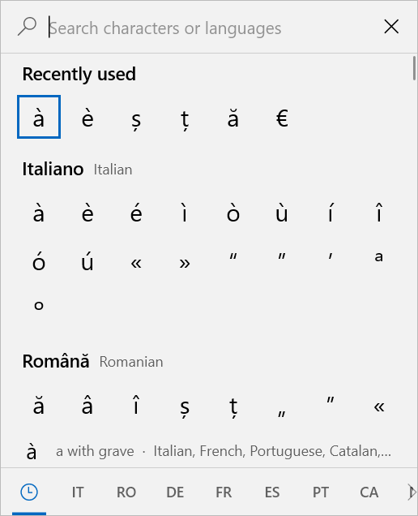
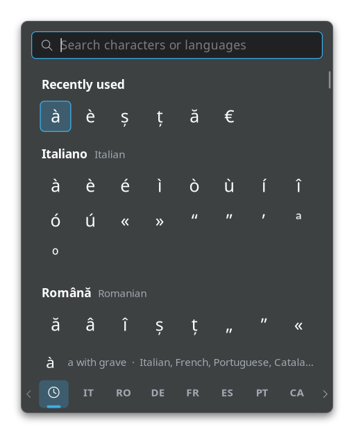

# Charpick

Charpick lets you type accented letters and symbols in any app: à, è, ș, ț, ß, ç, ñ, €, °, ±, and hundreds more. Press a shortcut, pick the character, and Charpick types it for you. You don't need to remember codes or change your keyboard layout.

It looks like the Windows emoji panel (Win+.), and runs on **Windows 10 and 11** and on **Linux with KDE Plasma**, where it looks like a Plasma app.

<p>
  
  
  
</p>

- **Italian** comes first, then **Romanian**, German, French, Spanish and Portuguese. Catalan, Dutch, the Nordic, Central European and Baltic languages, Turkish, Greek, Vietnamese and more follow, then punctuation, currency, math and other symbols.
- **Type to search** by letter (`s`), by name (`e grave`, `cedilla`, `euro`) or by language, in English, in the language itself or by code (`romanian`, `română`, `ro`).
- **Hold Shift** for uppercase. By default, Caps Lock also gives uppercase.
- It matches the **Windows 10 or Windows 11** look by itself, and on Plasma the **Breeze** look with your colors, accent color and font.
- It is small and light: on Windows a single 0.4 MB program that uses no CPU while it waits.

Charpick is free and open source software.

## Download

| Your computer | What to do |
| --- | --- |
| Windows 10 or 11 | Download **[Charpick-Setup.exe](https://github.com/elpideus/charpick/releases/latest/download/Charpick-Setup.exe)** and follow [Install on Windows](#install-on-windows) |
| Linux with KDE Plasma 6 | Follow [Install on Linux](#install-on-linux-kde-plasma): one line to paste |

Every version, with what changed, is on the [Releases page](https://github.com/elpideus/charpick/releases).

## Install on Windows

1. Download **[Charpick-Setup.exe](https://github.com/elpideus/charpick/releases/latest/download/Charpick-Setup.exe)**.
2. Open it: click it in your browser's downloads, or double-click it in your **Downloads** folder.
3. If a blue window says **"Windows protected your PC"**, click **More info**, then **Run anyway**. Windows shows this for programs that are not signed with a paid certificate. It does not mean anything is wrong.
4. Setup offers two options. If unsure, leave both ticked:
   - **Open Charpick with Win+L.** Windows asks once *"Do you want to allow this app to make changes to your device?"*: click **Yes**. [Why this is needed](#how-winl-is-taken-over).
   - **Start Charpick when I sign in.**
5. Click **Install**, then **Finish**. Charpick starts and says hello in a notification. Its icon sits in the taskbar corner, next to the clock (click the **^** arrow if you don't see it).

No administrator account is needed. Charpick installs for you only.

> [!IMPORTANT]
> **Win+L now opens Charpick instead of locking your PC.** To lock your PC, press **Ctrl+Win+L**, or choose **Lock this PC** in Charpick's tray menu. Your PC still locks by itself when you leave it.

**Rather keep Win+L for locking?** Untick the first option in Setup. Then right-click Charpick's tray icon, choose **Change shortcut…**, and press the shortcut you want, for example **Ctrl+Alt+Space**.

**To update** Charpick, download and run the newest `Charpick-Setup.exe`. It replaces the old version and keeps your settings.

**To uninstall** it, open **Settings → Apps → Installed apps** (on Windows 10: **Apps & features**), find **Charpick** and choose **Uninstall**. This gives Win+L back to Windows and removes Charpick's settings. Windows asks for approval once more, to undo the one-time permission. If you decline, the leftover permission is harmless: it only lets your own account change your own "disable lock" setting.

## Install on Linux (KDE Plasma)

Charpick needs **KDE Plasma 6** in a **Wayland** session, the default on current KDE systems. To check, open **System Settings → About this System**: it should say *KDE Plasma Version: 6.something* and *Graphics Platform: Wayland*.

1. Open **Konsole**: press the Meta key (the Windows key), type `Konsole` and press Enter.
2. Copy this line, paste it into Konsole with **Ctrl+Shift+V**, and press **Enter**:

   ```bash
   curl -fsSL https://github.com/elpideus/charpick/releases/latest/download/charpick-linux-x86_64.tar.gz | tar xz -C /tmp && sh /tmp/charpick/install.sh
   ```

3. Charpick starts and says hello in a notification. Its icon is in the system tray.

It doesn't ask for your password: Charpick installs into your home folder, for you only. It also starts by itself when you log in. To stop that, untick **Start at login** in its tray menu.

**To update** Charpick, run the same line again. Your settings stay as they are.

**To uninstall** it, run:

```bash
curl -fsSL https://github.com/elpideus/charpick/releases/latest/download/charpick-linux-x86_64.tar.gz | tar xz -C /tmp && sh /tmp/charpick/install.sh --uninstall
```

This removes the program, its menu entry, its login entry and its shortcut, and keeps your settings. Put `--purge` after `--uninstall` to delete the settings too.

**Prefer not to paste a command from the internet?** Download [charpick-linux-x86_64.tar.gz](https://github.com/elpideus/charpick/releases/latest/download/charpick-linux-x86_64.tar.gz). In Dolphin, right-click it and choose **Extract → Extract archive here**. Open the `charpick` folder; `install.sh` in it is the script the line above runs, and you can read it first. Then press **Shift+F4** to open a terminal in that folder, type `sh install.sh` and press Enter.

## How to use it

1. Click where you want to type: a document, an email, a chat, a search box.
2. Press **Win+L** on Windows, or **Meta+,** on KDE Plasma (Meta is the Windows key, `,` is the comma key).
3. Type a few letters to search, for example `e grave`, `cedilla`, `euro` or `romanian`.
4. Pick the character with the arrow keys and press **Enter**, or click it. Charpick types it in your app.

Hold **Shift** for uppercase letters. **Esc** closes Charpick without typing anything.

| Key | Action |
| --- | --- |
| Win+L (Windows), Meta+, (Plasma) | Open or close the picker |
| Typing | Search |
| ← → ↑ ↓, Page Up/Down, Home/End | Move the selection |
| Tab / Shift+Tab | Next / previous language |
| Enter | Type the character and close |
| Shift (held) | Uppercase letters |
| Backspace / Ctrl+Backspace | Delete a character / a word of the search |
| Delete | Clear the search |
| Esc | Clear the search, then close |
| **Ctrl+Win+L** (Windows) | Lock the PC |

- The mouse wheel scrolls; the tabs at the bottom jump to a language.
- Clicking anywhere else, or switching windows, closes the picker.
- Recently used characters come first.

Right-click Charpick's **tray icon** for its menu:

- **Change shortcut…**: press the new combination and it is saved.
- **Style** (Automatic, Windows 10, Windows 11, KDE Plasma) and **Theme** or **Colors** (Automatic, Light, Dark).
- **Start with Windows** or **Start at login**.
- **Clear recently used**, **Edit settings…**, **How to use** and **Quit Charpick**.
- On Windows also **Lock this PC**.

## Questions and problems

**Windows: Win+L still locks my PC.** The one-time Win+L setup was skipped. Right-click Charpick's tray icon, choose **Let Win+L open Charpick…** and click **Yes** when Windows asks. Or pick another shortcut with **Change shortcut…**.

**Windows: how do I lock my PC now?** Press **Ctrl+Win+L**, or choose **Lock this PC** in the tray menu. Automatic locking keeps working: when the PC is idle, when it wakes from sleep, and with Dynamic Lock.

**Windows: the character is not typed in one app.** Windows does not let normal programs type into apps that run as administrator. Charpick opens over them, but cannot insert the character there.

**Windows: the picker opens next to the mouse instead of next to the text.** Some apps don't tell Windows where their text cursor is. Charpick then opens next to the mouse pointer.

**Linux: Konsole says `curl: command not found`.** Install curl first: `sudo apt install curl` on Kubuntu and KDE neon, then run the line again.

**Linux: Charpick does not start, or says it cannot start.** It needs a Wayland session. Log out, and on the login screen choose **Plasma (Wayland)** before logging back in.

**Linux: the shortcut does nothing.** Open **System Settings → Keyboard → Shortcuts → Charpick** and check the shortcut there, or set a new one with **Change shortcut…** in the tray menu.

**Something else?** [Open an issue](https://github.com/elpideus/charpick/issues) and describe what happens.

## Windows in detail

### How Win+L is taken over

Windows handles Win+L itself, before any app can see the key. The only supported way to stop it is the per-user policy `DisableLockWorkstation`. Charpick sets that policy only while it is needed:

- It is set the moment you press the Win key, so Win+L opens the picker.
- It is cleared after 30 seconds without keyboard or mouse input, before sleep, when the screen turns off, when the session locks and when Charpick exits.

So automatic locks keep working: the idle timeout, locking on resume, and Dynamic Lock. *Ctrl+Alt+Del → Lock* and *Start → Lock* are hidden only from the moment you press the Win key until the PC has been idle for 30 seconds.

To lock the PC, press **Ctrl+Win+L** or choose **Lock this PC** in the tray menu. Locking from the Start menu also works once the 30 seconds have passed.

That policy key can normally be changed only by administrators. The one-time setup (installer option or tray menu → *Let Win+L open Charpick…*) lets your own account change that single value. The change applies to `HKCU\Software\Microsoft\Windows\CurrentVersion\Policies\System`.

If you skip the setup, Win+L keeps locking the PC and the picker cannot open. In that case, either run the setup from the tray menu or pick another shortcut: tray menu → *Change shortcut…*, or `hotkey = Ctrl+Alt+Space` in the settings.

If your organization already disables locking through policy, Charpick detects that. Win+L then simply opens the picker.

### Picker behavior

- The picker opens next to the text cursor: to its right, or to its left when there is no room.
- Clicking a character types it and leaves the picker open. To have clicks close it too, set `close_on_click = on`.
- The picker never takes the keyboard focus away from your app, just like the emoji panel. Your text cursor and selection stay where they were.

### Settings

The tray menu's **Edit settings** opens `%APPDATA%\Charpick\settings.ini`. Changes apply the next time the picker opens.

| Setting | Values | Default |
| --- | --- | --- |
| `style` | `auto`, `win10`, `win11`, `kde` | `auto` (detects Windows 10 or 11) |
| `theme` | `auto`, `light`, `dark` | `auto` (follows Windows) |
| `backdrop` | `auto`, `acrylic`, `solid` | `auto` (acrylic when transparency effects are on) |
| `hotkey` | e.g. `Win+L`, `Ctrl+Alt+Space`, `Win+Shift+K`, or `none` | `Win+L` |
| `lock_hotkey` | a shortcut, or `none` | `Ctrl+Win+L` |
| `order` | section codes; `*` means "everything else" | `it, ro, de, fr, es, pt, *` |
| `recent_count` | 0–64 | 16 |
| `close_on_click` | `on` / `off` | `off` |
| `caps_lock_uppercase` | `on` / `off` | `on` |
| `gpu` | `on` / `off` (CPU rendering is lighter for a window this small) | `off` |

Section codes:

- Languages: `it ro de fr es pt ca nl sv no da fi is pl cs sk hu hr sl tr et lv lt sq mt cy ga eo vi el`
- Symbols: `punct currency math numbers misc`

### Limitations

- Windows does not let a normal app type into **apps running as administrator** (UIPI). The picker opens over them, but the character is not inserted.
- The text cursor position comes from accessibility APIs. Apps that do not report it get the picker next to the mouse pointer instead.
- While the picker is open it reads the keyboard through a low-level hook, as the emoji panel does. Keys that are not meant for the picker close it and pass through: shortcuts with Ctrl, Alt or Win.

## Linux in detail

Charpick uses KWin to show the picker above other windows and to type the character, and Plasma's shortcut service for its shortcut.

The installer puts:

- the program in `~/.local/bin/charpick`
- an entry in the application launcher, `~/.local/share/applications/charpick.desktop`
- start at login, `~/.config/autostart/charpick.desktop`. Leave it out with `sh install.sh --no-autostart`, or turn it off later in the tray menu.

### The shortcut

The default is **Meta+,**. Charpick registers it as a Plasma global shortcut, so it works in every app.

To change it:

- **Tray menu → Change shortcut…** Then hold Ctrl, Alt or Meta and press a key. Esc cancels. A combination that another shortcut already uses is refused, and the old one stays. The same prompt opens with `charpick --change-shortcut`, or by right-clicking Charpick in the application launcher.
- **System Settings → Keyboard → Shortcuts → Charpick.**
- **settings.ini:** `hotkey = Ctrl+Alt+Space`. `hotkey = none` means no shortcut; open the picker from the tray icon instead.

The three stay in sync: a change in one place shows up in the others.

### Picker behavior

The keys are the same as on Windows, with Meta+, in place of Win+L. Some things differ:

- The picker opens in the middle of the screen. Wayland does not tell an app where another app's text cursor is.
- The picker takes the keyboard while it is open. **Enter** or a **click** gives the keyboard back to your app, types the character there and closes the picker. Clicking outside the picker or pressing Esc closes it.
- Characters missing from your keyboard layout are typed too.
- Clicking the tray icon opens and closes the picker.

### Look

- **Style → Automatic** (or `style = kde`) draws the picker like a Breeze dialog. It uses the colors of your Plasma color scheme, its accent color and the Plasma font. A new color scheme applies the next time the picker opens. The Windows 10 and Windows 11 styles are available too.
- **Colors** follows the color scheme, or forces light or dark. Forced light or dark uses Breeze colors with your accent color.
- The background behind the picker is blurred when KWin supports it. Set `backdrop = solid` for a plain one.
- Scaled displays, including fractional scaling such as 125% or 150%, are drawn sharp.

### Settings

The tray menu's **Edit settings…** opens `~/.config/charpick/settings.ini`. Changes apply within a few seconds. The settings are the ones in [Windows settings](#settings), except:

- `style` defaults to `auto`, which means the KDE Plasma look.
- `backdrop` is `auto`, `blur` or `solid`.
- `hotkey` defaults to `Meta+,`.
- `lock_hotkey`, `close_on_click` and `gpu` are Windows only.

### Command line

```text
charpick                     start Charpick (or greet, when it is already running)
charpick --toggle            open or close the picker
charpick --show              open the picker
charpick --change-shortcut   choose a new shortcut
charpick --quit              stop the running Charpick
charpick --style auto|kde|win11|win10   (also --theme, --backdrop) override the settings for one run
charpick --log               print what happens to the terminal
```

Only one Charpick runs per session. Starting it again passes the option to the running one.

### Other desktops

KDE Plasma is the supported desktop. X11 sessions and GNOME do not work: Charpick needs the Wayland layer-shell protocol, which GNOME does not offer. Other Wayland compositors with layer-shell, such as Sway or Hyprland, are untested. On them, Charpick should start with two differences:

- Bind `charpick --toggle` to a key in the compositor's settings.
- The character is copied to the clipboard instead of typed. A notification tells you to press Ctrl+V.

## Building from source

### Linux

Building needs Rust ([rustup.rs](https://rustup.rs)), `pkg-config`, and the development files for cairo, pango and libxkbcommon:

| Distribution | Packages |
| --- | --- |
| Arch, CachyOS, Manjaro, EndeavourOS | `cairo pango libxkbcommon pkgconf` (usually installed already) |
| Debian, Ubuntu, KDE neon, Kubuntu | `pkg-config libcairo2-dev libpango1.0-dev libxkbcommon-dev` |
| Fedora, openSUSE | `pkgconf cairo-devel pango-devel libxkbcommon-devel` |

Then, in the source folder:

- `sh installer/install-linux.sh` builds Charpick and installs it, as the release download does. It takes the same options (`--no-autostart`, `--uninstall`, `--purge`).
- `sh installer/build-linux.sh` builds the release download, `dist/charpick-linux-x86_64.tar.gz`.
- `cargo build --release` alone builds `target/release/Charpick`.

### Windows

The requirements are:

- Rust (stable, MSVC toolchain)
- Inno Setup 6.3 or later, for the installer

```bash
powershell -NoProfile -ExecutionPolicy Bypass -File installer/build.ps1
```

This builds `target\release\Charpick.exe` and `dist\Charpick-Setup.exe`.

Command-line options on Windows:

- `--demo` opens the picker right away.
- `--change-shortcut` opens the shortcut prompt.
- `--style`, `--theme` and `--backdrop` override the settings for one run.
- `--quit` closes the running copy.
- `--log` replaces the running copy with one that writes a diagnostic log to `%APPDATA%\Charpick\debug.log`. The log records only modifier keys, the shortcut keys and the picker's own events, never what you type. The next sign-in starts Charpick without the log again.

### Both systems

- `cargo test` runs the unit tests (catalog, search, settings parsing).
- `cargo run --release --features snapshot -- --snapshot out.png --style win10 --theme dark --query ro` renders the picker to a PNG without showing it. Add `--style kde` for the Plasma look, or `--prompt` for the shortcut prompt.
- `tools/make-icons.ps1` regenerates the icons in `assets/`.

Code layout:

| File | Contents |
| --- | --- |
| `src/app.rs` | Tray icon, windows, message handling |
| `src/picker.rs` | Layout, drawing (through the `Canvas` trait in `src/gfx.rs`), keyboard and mouse |
| `src/d2d.rs` | Direct2D/DirectWrite drawing |
| `src/hook.rs` | Low-level keyboard/mouse hooks, typing with `SendInput` |
| `src/caret.rs` | Text cursor position (Win32 caret → MSAA → UI Automation) |
| `src/diag.rs` | The opt-in diagnostic log (`--log`) |
| `src/lockpolicy.rs` | The Win+L policy and its one-time setup |
| `src/data.rs` | Character catalog and search |
| `src/theme.rs`, `src/settings.rs`, `src/util.rs` | Look (Windows 10/11 and KDE Plasma), settings, helpers |
| `src/linux/mod.rs` | Linux: start-up, commands, keeping the shortcut in sync with Plasma |
| `src/linux/wl.rs` | Linux: the Wayland panel (layer-shell), keyboard and mouse, typing through KWin |
| `src/linux/paint.rs` | Linux: Cairo/Pango drawing |
| `src/linux/dbus.rs` | Linux: Plasma's shortcut service (KGlobalAccel) and notifications |
| `src/linux/kde.rs` | Linux: reading the Plasma color scheme and font |
| `src/linux/tray.rs`, `src/linux/ipc.rs` | Linux: tray icon and menu; one Charpick per session |

## Making a release

Every push to `main` and every pull request runs the checks in [`.github/workflows/ci.yml`](.github/workflows/ci.yml): formatting, clippy and the tests on Windows and Linux, the shell scripts, and that the version agrees everywhere it is written.

A release is a `v*` tag. To cut one from an up-to-date, clean `main`:

```bash
scripts/release.sh 1.0.4           # or 1.1.0-beta.1 for a pre-release
```

The script sets the version in `Cargo.toml`, `Cargo.lock`, `charpick.rc` and `installer/charpick.iss` (`scripts/version.sh`), commits it as *Release v1.0.4*, tags it and pushes both. The tag starts [`.github/workflows/release.yml`](.github/workflows/release.yml), which runs the checks again, builds `Charpick-Setup.exe` on Windows and `charpick-linux-x86_64.tar.gz` on Ubuntu 22.04, and publishes a GitHub release with them, their `SHA256SUMS`, and notes listing the commits since the previous release (`scripts/release-notes.sh`). A version with a `-` is published as a pre-release, which the download links above skip.

Running the Release workflow by hand (Actions → Release → Run workflow) builds the downloads from any branch and keeps them as workflow artifacts, without publishing anything.

## License

Charpick is free software: you can redistribute it and/or modify it under the terms of the GNU General Public License as published by the Free Software Foundation, either version 3 of the License, or (at your option) any later version. See [`LICENSE`](LICENSE).

It is distributed in the hope that it will be useful, but without any warranty; without even the implied warranty of merchantability or fitness for a particular purpose.
